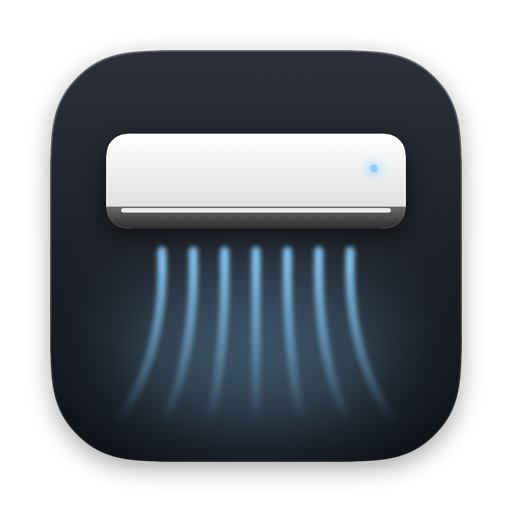
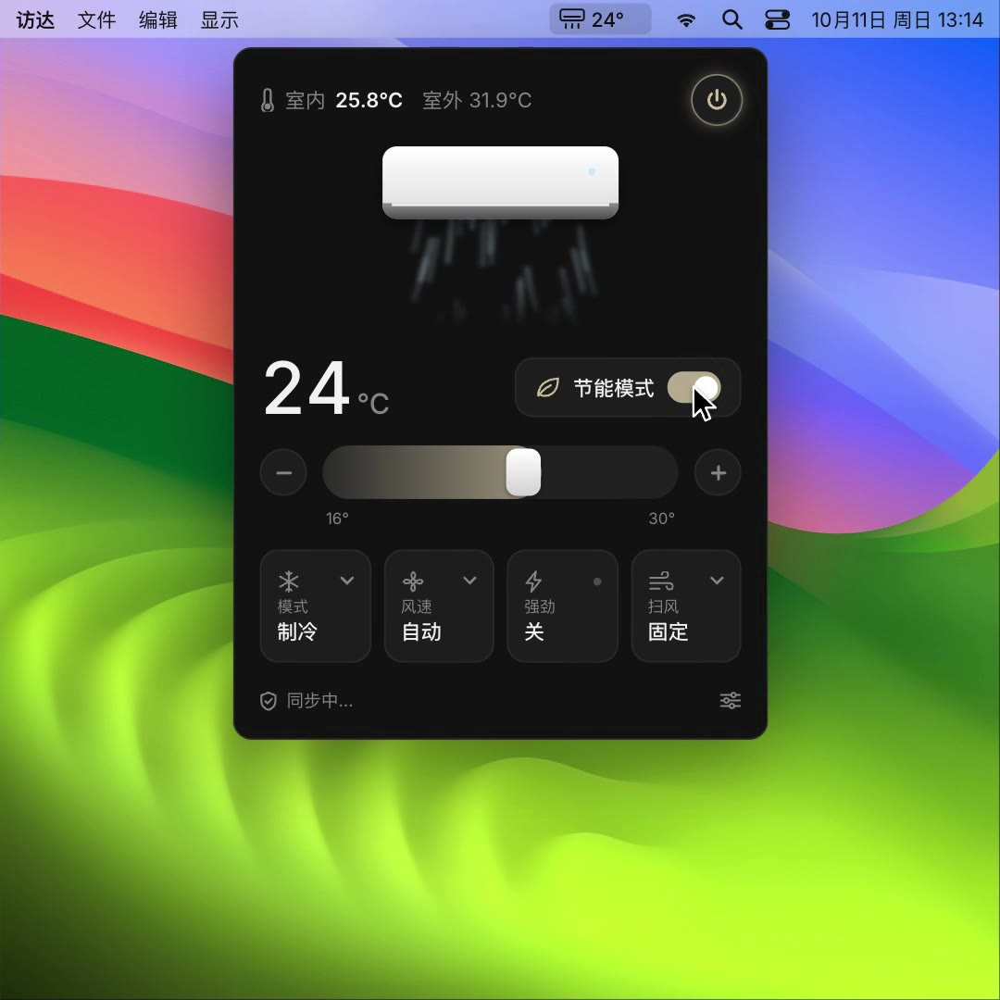

<p align="center">
  
</p>

<h1 align="center">MideaBar</h1>

<p align="center">Control Midea / Hualing air conditioners from the macOS menu bar over Bluetooth — no phone app, no cloud.</p>

<p align="center">
  <a href="https://github.com/Binaryify/MideaBar/actions/workflows/ci.yml"></a>
  <a href="https://github.com/Binaryify/MideaBar/releases"></a>
  
  
  <a href="LICENSE"></a>
</p>

<p align="center"><a href="README.md">简体中文</a> · English</p>

<p align="center"><a href="https://binaryify.github.io/MideaBar/?lang=en">Website</a> · <a href="website/assets/demo.mp4">Demo video</a> · <a href="docs/protocol.en.md">Bluetooth protocol</a></p>

<p align="center">
  <a href="website/assets/demo.mp4"></a>
</p>

> ⚠️ **Disclaimer**
>
> This is a personal open-source project. It is not affiliated with or authorized by Midea Group or any of its sub-brands; "Midea", "Hualing" and related names and trademarks belong to their respective owners.
> The Bluetooth protocol comes from public research into device behavior and is provided for learning and for use with your own devices only. You use this project at your own risk.

## Features

- Shows the set temperature in the menu bar; click it to open the control panel
- Power, temperature (16–30℃ in 0.5° steps), mode, fan speed, swing, Eco and Turbo
- Shows indoor / outdoor temperature; the AC illustration blows air while it's on
- Changes apply instantly (optimistic updates) and roll back to the device's real state on failure
- Direct Bluetooth — no pairing, account or extra programs; reconnects automatically
- UI in Simplified Chinese / English — follows the system language by default, or switch manually

## How it works

```
SwiftUI UI (ControlPanel / ACStore)
   │
ACLink (CoreBluetooth: scan, connect, retries, reconnect)
   │
MideaProtocol (frames, AES-CCM, ECDH handshake, appliance frames)
   │  BLE
   ▼
Air conditioner
```

The app reads the serial number and MAC from the AC's Bluetooth advertisement, derives a root key, negotiates a session key through an ECDH handshake, and then exchanges encrypted Midea appliance frames for control and status. See [docs/protocol.en.md](docs/protocol.en.md) for the full description.

The protocol part (`MideaProtocol`) is pure Swift with no Bluetooth dependency and is unit-tested; the conformance vectors come from the reference implementation [midea-ble-go](https://github.com/midea-ble/midea-ble-go).

## Installation

1. Download `MideaBar-*.zip` from [Releases](https://github.com/Binaryify/MideaBar/releases), unzip it and drag `MideaBar.app` into Applications. Requires macOS 14+; universal binary for Apple silicon and Intel.
2. The app is not notarized by Apple. Before opening it for the first time, run:

   ```bash
   xattr -dr com.apple.quarantine /Applications/MideaBar.app
   ```

3. Open MideaBar and allow Bluetooth access when prompted. It scans for nearby ACs, connects to the strongest one, and prefers that unit from then on.

So far verified only on the author's own AC. Other Bluetooth-enabled Midea / Hualing models should work in principle — please report results in [Issues](https://github.com/Binaryify/MideaBar/issues).

## Building from source

Requires macOS 14+ and Xcode.

```bash
git clone https://github.com/binaryify/MideaBar.git
cd MideaBar
make test   # protocol unit tests
make run    # build and launch
```

The result is `build/MideaBar.app`.

`make dist` additionally packs a release zip. Pushing a `v*` tag (e.g. `v0.1.0`) makes GitHub Actions build and publish it to Releases.

macOS asks for Bluetooth permission on first launch — allow it. **Launch the app from Finder or with `open`**: if you run the executable inside the app directly from a terminal, the Bluetooth permission is attributed to the terminal instead. Local builds are ad-hoc signed, so macOS asks for Bluetooth permission again after every rebuild.

### Debug logs

The connection process is written to the system log:

```bash
log stream --info --predicate 'subsystem == "com.github.binaryify.mideabar"'
```

### UI language

The UI follows the system language by default and currently supports Simplified Chinese and English. You can also switch manually in the settings menu at the bottom-right of the panel → "Language" (the app restarts automatically). Source code uses the Chinese text directly (`Text("室内")`, `String(localized: "制冷")`), and that Chinese text is the translation key; English translations live in [Resources/en.lproj/Localizable.strings](Resources/en.lproj/Localizable.strings). To add a language: add `Resources/<lang>.lproj/`, register it under `CFBundleLocalizations` in `Info.plist`, and add a case to `AppLanguage`.

Documents also come in both languages (`README.md` / `README.en.md`, `docs/protocol.md` / `docs/protocol.en.md`) — please keep both in sync. The website's English copy is in the `EN` object in the script at the end of `website/index.html`.

### Changing the icon

The icon is drawn in SwiftUI by [Icon/make-icon.swift](Icon/make-icon.swift). Regenerate it after editing:

```bash
make icon
```

## Project structure

```
MideaBar/
├── Sources/MideaBar/
│   ├── MideaBarApp.swift   # Entry point: menu bar icon and temperature
│   ├── ControlPanel.swift  # Control panel and its controls
│   ├── ACUnitView.swift    # AC illustration and airflow animation
│   ├── ACStore.swift       # State: device status → UI, user actions → commands
│   ├── ACLink.swift        # CoreBluetooth: scan, connect, handshake timing, retries, reconnect
│   ├── AppLanguage.swift   # UI language: follow system / manual switch
│   └── Models.swift        # Labels and icons for mode / fan speed / swing
├── Sources/MideaProtocol/  # Bluetooth protocol: frames, crypto, handshake, appliance frames
├── Tests/                  # Protocol unit tests
├── Icon/make-icon.swift    # Icon source
├── Resources/              # Info.plist, AppIcon.icns, *.lproj (UI translations)
├── docs/protocol.md        # Bluetooth protocol (English: .en.md)
└── website/                # Website (GitHub Pages, Chinese / English), demo video and icons
```

## License

[MIT](LICENSE)
